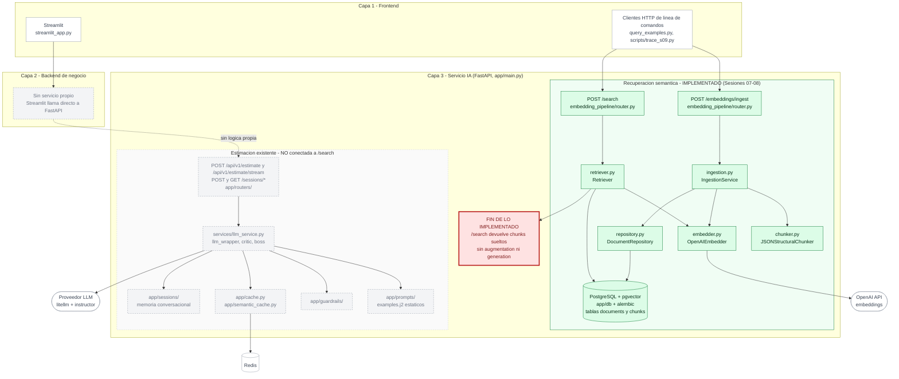
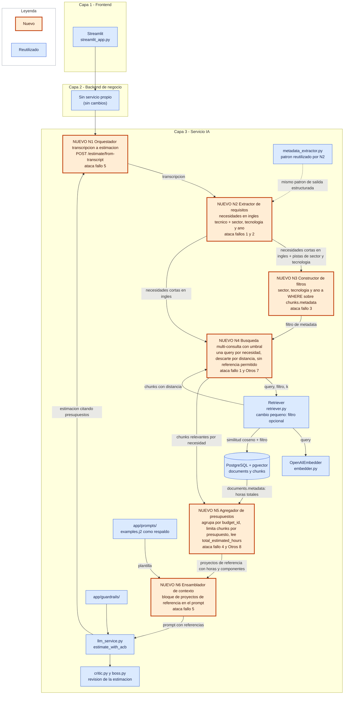

# Diagnóstico arquitectónico — Sesión 09 (pre-work)

---

## 1. Diagrama de la arquitectura actual

Nota honesta: no existe un backend de negocio separado. La capa 2 está dibujada pero sin servicio
propio: Streamlit (`streamlit_app.py`) habla directamente con FastAPI por HTTP. El servicio IA
está un nivel más abajo, con los módulos reales del repositorio.



Lectura del diagrama:

- Streamlit solo consume los endpoints de estimación (`/api/v1/estimate*`, `/sessions/*`); no usa `/search` ni `/embeddings/ingest`. Los únicos clientes de esos dos endpoints son los scripts de línea de comandos.
- Ingesta: `router.py` → `IngestionService` → `JSONStructuralChunker` (un componente = un chunk) → `OpenAIEmbedder` (vectores de 1536 dimensiones) → `DocumentRepository` → tablas `documents` y `chunks`.
- Búsqueda: `POST /search` → `Retriever` embebe la query con el mismo `OpenAIEmbedder` y ordena `chunks` por distancia coseno en PostgreSQL. Devuelve `chunks` sueltos con su `distance` y su `metadata`.
- La implementación del RAG acaba ahí (caja roja): el resultado de `/search` no entra en ningún otro módulo.
- La rama gris (estimación con `llm_service.py`, prompts, guardrails, caché y memoria) funciona por separado y sigue calibrándose con `examples.j2` estáticos, no con presupuestos recuperados.

---

## 2. Trace anotado de `02_ambiguous.txt`

Estado del corpus durante el trace (comandos ejecutados tras `docker compose up --build -d` y
`docker compose run --rm ai_service python query_examples.py`, que ingirió 2 presupuestos nuevos y
dio 409 en los otros 15):

```powershell
docker compose exec -T postgres psql -U estimator -d estimator -c "SELECT (SELECT count(*) FROM documents) AS documents, (SELECT count(*) FROM chunks) AS chunks;"
docker compose exec -T postgres psql -U estimator -d estimator -c "SELECT indexname FROM pg_indexes WHERE indexdef ~* 'hnsw|ivfflat|diskann';"
```

```text
 documents | chunks
-----------+--------
        17 |     60

 indexname
-----------
(0 rows)
```

Hay 17 presupuestos / 60 chunks y ningún índice vectorial (la búsqueda es un scan exacto).

### Paso 1 — Embeber la transcripción completa

Comando (el script imprime los pasos 1 y 2 en una sola ejecución):

```powershell
uv run python scripts/trace_s09.py examples/transcripts/02_ambiguous.txt
```

Salida real del paso 1:

```text
== Paso 1: embedding de la transcripción completa ==
chars: 2854
dimensionality: 1536
l2_norm: 0.999691
first_component: 0.00623321533203125
last_component: 0.019012451171875
```

Comentario: el vector tiene 1536 dimensiones (el modelo `text-embedding-3-small`, el mismo de la ingesta) y norma ≈ 1, así que
la distancia coseno equivale a comparar direcciones. Ese único punto es un promedio de las cinco
intenciones del cliente (vender online, fidelización, panel de ventas, pago con tarjeta, correo de pedido)
mezclado con ruido conversacional (anécdotas familiares, dudas, "no quiero liarlo"): no representa ninguna necesidad en concreto.
Los componentes sueltos no son interpretables; solo la dirección global importa.

### Paso 2 — Búsqueda semántica (top-5)

Salida real del paso 2 (mismo script). La respuesta incluye `query` con la transcripción completa; aquí se
sustituye por un marcador para no repetirla (y no reproducir nombres propios). El resto del JSON está tal cual.

<details>
<summary>Respuesta cruda de POST /search (k=5)</summary>

```json
{
  "query": "<transcripción completa, 2853 caracteres tras strip(); omitida en este documento>",
  "k": 5,
  "search_time_ms": 290,
  "results": [
    {
      "chunk_id": 16,
      "document_id": 5,
      "chunk_type": "budget_component",
      "content": "[Project: Headless e-commerce storefront with personalized recommendations]\n[Client sector: ecommerce | Year: 2024 | Main tech: node]\n\nComponent: Product catalog API\nDescription: GraphQL catalog API with faceted search, inventory availability and multi-currency pricing backed by Elasticsearch.\nTech stack: node, graphql, elasticsearch\nComplexity: medium\nEstimated hours: 150",
      "distance": 0.6104631454402794,
      "metadata": {
        "year": 2024,
        "chunk_id": "BUD-2024-005::CATALOG-001",
        "budget_id": "BUD-2024-005",
        "complexity": "medium",
        "tech_stack": [
          "node",
          "graphql",
          "elasticsearch"
        ],
        "token_count": 76,
        "component_id": "CATALOG-001",
        "dependencies": [],
        "client_sector": "ecommerce",
        "component_name": "Product catalog API",
        "estimated_hours": 150,
        "main_technology": "node"
      }
    },
    {
      "chunk_id": 17,
      "document_id": 5,
      "chunk_type": "budget_component",
      "content": "[Project: Headless e-commerce storefront with personalized recommendations]\n[Client sector: ecommerce | Year: 2024 | Main tech: node]\n\nComponent: Cart and checkout service\nDescription: Stateless cart service with promotion engine, tax calculation and a checkout orchestration that integrates the payment provider.\nTech stack: node, redis, postgresql\nComplexity: high\nEstimated hours: 140",
      "distance": 0.6158778729881826,
      "metadata": {
        "year": 2024,
        "chunk_id": "BUD-2024-005::CART-002",
        "budget_id": "BUD-2024-005",
        "complexity": "high",
        "tech_stack": [
          "node",
          "redis",
          "postgresql"
        ],
        "token_count": 78,
        "component_id": "CART-002",
        "dependencies": [
          "CATALOG-001"
        ],
        "client_sector": "ecommerce",
        "component_name": "Cart and checkout service",
        "estimated_hours": 140,
        "main_technology": "node"
      }
    },
    {
      "chunk_id": 18,
      "document_id": 5,
      "chunk_type": "budget_component",
      "content": "[Project: Headless e-commerce storefront with personalized recommendations]\n[Client sector: ecommerce | Year: 2024 | Main tech: node]\n\nComponent: Personalized recommendations\nDescription: Collaborative-filtering recommendations served from a feature store and exposed as a low-latency API for product and cart pages.\nTech stack: node, redis\nComplexity: medium\nEstimated hours: 110",
      "distance": 0.6395542272161213,
      "metadata": {
        "year": 2024,
        "chunk_id": "BUD-2024-005::RECO-003",
        "budget_id": "BUD-2024-005",
        "complexity": "medium",
        "tech_stack": [
          "node",
          "redis"
        ],
        "token_count": 78,
        "component_id": "RECO-003",
        "dependencies": [
          "CATALOG-001"
        ],
        "client_sector": "ecommerce",
        "component_name": "Personalized recommendations",
        "estimated_hours": 110,
        "main_technology": "node"
      }
    },
    {
      "chunk_id": 19,
      "document_id": 5,
      "chunk_type": "budget_component",
      "content": "[Project: Headless e-commerce storefront with personalized recommendations]\n[Client sector: ecommerce | Year: 2024 | Main tech: node]\n\nComponent: Storefront PWA\nDescription: Progressive web app storefront consuming the headless APIs with server-side rendering for SEO.\nTech stack: next_js, react\nComplexity: low\nEstimated hours: 60",
      "distance": 0.6404443481253255,
      "metadata": {
        "year": 2024,
        "chunk_id": "BUD-2024-005::STORE-004",
        "budget_id": "BUD-2024-005",
        "complexity": "low",
        "tech_stack": [
          "next_js",
          "react"
        ],
        "token_count": 72,
        "component_id": "STORE-004",
        "dependencies": [
          "CART-002"
        ],
        "client_sector": "ecommerce",
        "component_name": "Storefront PWA",
        "estimated_hours": 60,
        "main_technology": "node"
      }
    },
    {
      "chunk_id": 27,
      "document_id": 8,
      "chunk_type": "budget_component",
      "content": "[Project: Fashion returns management and resale portal]\n[Client sector: ecommerce | Year: 2023 | Main tech: dotnet]\n\nComponent: Returns portal\nDescription: Self-service returns portal with label generation, reason capture and automatic restock or resale routing.\nTech stack: dotnet, sqlserver\nComplexity: medium\nEstimated hours: 140",
      "distance": 0.6432174995124424,
      "metadata": {
        "year": 2023,
        "chunk_id": "BUD-2024-008::RET-001",
        "budget_id": "BUD-2024-008",
        "complexity": "medium",
        "tech_stack": [
          "dotnet",
          "sqlserver"
        ],
        "token_count": 72,
        "component_id": "RET-001",
        "dependencies": [],
        "client_sector": "ecommerce",
        "component_name": "Returns portal",
        "estimated_hours": 140,
        "main_technology": "dotnet"
      }
    }
  ]
}
```

</details>

Tabla resumen que imprime el script (el preview de 120 caracteres queda ocupado casi por completo por el header `[Project: ...]`, por eso aquí se omite):

```text
rank | chunk_id | distance | client_sector | budget_id | component_id
1 | 16 | 0.6105 | ecommerce | BUD-2024-005 | CATALOG-001
2 | 17 | 0.6159 | ecommerce | BUD-2024-005 | CART-002
3 | 18 | 0.6396 | ecommerce | BUD-2024-005 | RECO-003
4 | 19 | 0.6404 | ecommerce | BUD-2024-005 | STORE-004
5 | 27 | 0.6432 | ecommerce | BUD-2024-008 | RET-001
```

Equivalente con `curl.exe` (PowerShell 5.1). El JSON se escribe en un fichero temporal fuera del repositorio (`$env:TEMP`) y
se envía con `--data-binary`; la salida de este `curl.exe` dio las mismas distancias que el script:

```powershell
$q = [System.IO.File]::ReadAllText("$PWD\examples\transcripts\02_ambiguous.txt", [System.Text.Encoding]::UTF8)
@{ query = $q; k = 5 } | ConvertTo-Json -Compress | Set-Content -Encoding utf8 "$env:TEMP\q02.json"
curl.exe -s -S -X POST http://localhost:8000/search -H "Content-Type: application/json" --data-binary "@$env:TEMP\q02.json" -o "$env:TEMP\r02.json" -w "HTTP %{http_code}`n"
```

Tip de PowerShell 5.1 que observé: si el texto se lee con `Get-Content -Raw`, `ConvertTo-Json` serializa la cadena como un objeto
`{"value": ...}` y la API responde `422 string_type` (`Input should be a valid string`); `ReadAllText` evita el problema.

Comentario: la API responde 200 en ~290 ms y `search_time_ms` incluye la llamada a OpenAI para embeber la query más
el SQL. Las distancias están en un rango muy estrecho (0.6105–0.6432, diferencia top1–top5 = 0.0328) y 4 de 5 chunks son del mismo presupuesto.

### Paso 3 — Lectura de los chunks devueltos

Necesidades del cliente: (a) vender por internet, (b) fidelización con puntos/club, (c) panel de ventas con stock y pedidos diarios,
(d) pago con tarjeta, (e) correo de confirmación de pedido.

| # | Presupuesto histórico (horas totales del padre) | Sector | Componente (horas) | ¿Relevante? |
|---|---|---|---|---|
| 1 | BUD-2024-005 — headless e-commerce (460 h) | ecommerce | Product catalog API (150) | Sí: cubre (a) catálogo y disponibilidad de stock. |
| 2 | BUD-2024-005 | ecommerce | Cart and checkout service (140) | Sí, el mejor chunk: carrito + checkout con proveedor de pagos, cubre (d) y la preocupación del carrito abandonado. |
| 3 | BUD-2024-005 | ecommerce | Personalized recommendations (110) | No: el cliente no pidió recomendaciones; se parece a "fidelizar" solo por ruido semántico. |
| 4 | BUD-2024-005 | ecommerce | Storefront PWA (60) | Parcial: la tienda web (a); es el front, útil como referencia de tamaño. |
| 5 | BUD-2024-008 — devoluciones de moda (300 h) | ecommerce | Returns portal (140) | No: el cliente no habló de devoluciones. |

Lectura honesta: el sector es correcto (5/5 ecommerce) y los dos primeros chunks son buenos. Pero el top-5 cubre 2 de las 5 necesidades,
no trae nada de (b), (c) ni (e), y solo representa 2 presupuestos (uno ocupa 4 de 5 puestos). Parte de esto es del corpus:
no existe ningún componente de fidelización/puntos en los 17 presupuestos (`loyalty|points` solo aparece como "reorder points"), así que (b)
no se podría recuperar aunque la búsqueda fuera perfecta.

### Contraste con una query destilada

Consultas ejecutadas con `curl.exe` contra el mismo endpoint (k=5), igual que el comando anterior pero con otro `query`:

- Destilada en inglés (138 caracteres): `e-commerce online store with card payments, loyalty points program, sales dashboard with stock and daily orders, order confirmation emails`
- Destilada en español (152 caracteres): `tienda online con pago con tarjeta, programa de puntos de fidelización, panel de control con stock y pedidos diarios, correo de confirmación de pedido`

| Query | Rango de distancia (min–max) | top1–top5 | Presupuestos en el top-5 | Sectores | Componentes devueltos |
|---|---|---|---|---|---|
| Transcripción completa (2853 car.) | 0.6105–0.6432 | 0.0328 | BUD-005 ×4, BUD-008 ×1 | ecommerce ×5 | Catalog, Cart, Recommendations, Storefront PWA, Returns portal |
| Destilada EN (138 car.) | 0.4496–0.5142 | 0.0646 | BUD-005 ×2, BUD-017, BUD-006, BUD-003 | ecommerce ×4, finance ×1 | Cart and checkout, Order email, Split order management, Product catalog, Merchant dashboard |
| Destilada ES (152 car.) | 0.6017–0.6651 | 0.0634 | BUD-005 ×2, BUD-017 ×2, BUD-008 | ecommerce ×5 | Cart and checkout, Order email, Returns portal, Product catalog, Checkout |

Otras dos transcripciones, una línea cada una (mismo comando, solo para contraste):

- `01_clear.txt` (banca móvil, alcance claro): distancias 0.4212–0.4877, 5/5 finance, 4 chunks de BUD-001 + 1 de BUD-003. Con una necesidad clara la distancia baja ~0.2 y el top-5 es coherente.
- `03_hard.txt` (clínica, alcance abierto): distancias 0.5210–0.6185, 5/5 healthcare, 4 chunks de BUD-009 + 1 de BUD-010.

---

## 3. Diagnóstico: cinco fallos identificados

### Fallo 1 — La transcripción completa se usa como query
- **Problema observado:** la query son 2854 caracteres / 890 tokens con cinco necesidades distintas y ruido conversacional. Las distancias salen comprimidas: top1–top5 = 0.0328, la mitad que con la query destilada en español (0.0634), que tiene casi la misma distancia absoluta (0.6017–0.6651) y por tanto aísla el efecto del ruido y no el del idioma. Con la transcripción solo aparecen 2 presupuestos (BUD-005 ×4); la query destilada sí recupera "Order email" (BUD-017) y "Merchant dashboard" (BUD-003), que la transcripción nunca devuelve.
- **Causa probable:** un único vector es un promedio de todas las intenciones más el ruido (anécdotas, dudas); queda cerca de "tienda online genérica" y no de cada necesidad por separado.
- **Propuesta de solución:** extraer los requisitos de la transcripción (LLM con salida estructurada) y lanzar una búsqueda corta por requisito en lugar de una sola búsqueda con todo el texto.

### Fallo 2 — Desajuste de idioma entre la query y el corpus
- **Problema observado:** corpus en inglés técnico y transcripción en español coloquial. La misma query destilada da 0.4496–0.5142 en inglés y 0.6017–0.6651 en español: un desplazamiento de ~+0.15 en todo el top-5. El primer chunk es el mismo (`CART-002`), pero cambian los puestos 3–5 (el español trae "Returns portal" y "Checkout" en lugar de "Split order management" y "Merchant dashboard").
- **Causa probable:** el espacio de embeddings alinea parcialmente los idiomas: se conserva el orden aproximado, pero la distancia absoluta depende del idioma de la query; los chunks incluyen además un header en inglés (`[Project: ...]`, `[Client sector: ...]`).
- **Propuesta de solución:** normalizar la query a inglés técnico antes de buscar (en el mismo paso que extrae requisitos) y no fijar nunca umbrales de distancia sin calibrar por idioma.

### Fallo 3 — Recuperación sin filtro por metadata
- **Problema observado:** `Retriever.search` solo tiene `.where(Chunk.embedding.is_not(None))` (no filtra por negocio), aunque `chunks.metadata` guarda `client_sector`, `main_technology` y `year`, y hay un índice GIN (`ix_chunks_metadata_gin`) que no se usa. En la query destilada en inglés el puesto 5 es "Merchant dashboard" de BUD-2024-003, sector `finance`, para un proyecto e-commerce. Con la transcripción cruda salió 5/5 ecommerce sin ningún filtro, es decir, por proximidad semántica y no por diseño.
- **Causa probable:** la Sesión 08 implementó la recuperación semántica pura; los metadatos se guardaron "para más adelante". Además el sector está en `chunks.metadata.client_sector` pero en `documents.metadata` va anidado (`client_metadata.sector`), por lo que el filtro debe apoyarse en `chunks`.
- **Propuesta de solución:** inferir sector/tecnología/año en el paso de extracción y aplicarlos como filtro opcional (`WHERE` sobre `metadata`), con repliegue a búsqueda sin filtro si devuelve menos de `k`.

### Fallo 4 — Se devuelven componentes sueltos que saturan el top-k
- **Problema observado:** `SearchResult` solo tiene `chunk_id`, `document_id`, `chunk_type`, `content`, `distance` y `metadata`; no el presupuesto padre ni su `total_estimated_hours`, que vive en `documents.metadata` (consultado por SQL: BUD-005 = 460 h, BUD-008 = 300 h). En el trace, 4 de 5 chunks son de BUD-2024-005 (150 + 140 + 110 + 60 = 460 h: el presupuesto entero ocupa el top-k), así que k=5 aportó solo 2 proyectos de referencia.
- **Causa probable:** el chunking es "un componente = un chunk" y el retriever ordena chunks, sin agrupar por presupuesto ni limitar cuántos chunks aporta cada uno.
- **Propuesta de solución:** un paso de agregación que agrupe por `budget_id`, limite chunks por presupuesto, lea las horas totales del documento padre y devuelva "proyectos de referencia" (con sus componentes) en lugar de chunks sueltos.

### Fallo 5 — No hay augmentation ni generation: `/search` no se conecta con la estimación
- **Problema observado:** `Retriever`/`get_retriever` solo se referencian en `app/dependencies.py` y en `embedding_pipeline/router.py`; ni `services/llm_service.py` ni los prompts lo usan. Los prompts (`app/prompts/estimation/v1`–`v4`) incluyen `examples.j2` estáticos. El flujo real acaba en una lista de chunks: no hay ningún camino transcripción → estimación basada en presupuestos históricos.
- **Causa probable:** el RAG se construyó por sesiones (ingesta, búsqueda) en paralelo al CAG con ejemplos fijos; falta el pegamento que convierta la recuperación en contexto del prompt.
- **Propuesta de solución:** un orquestador que encadene extracción → recuperación → ensamblado de contexto → `llm_service` existente, con los proyectos de referencia citados en el prompt en lugar de los ejemplos fijos (que quedarían como respaldo).

### Otros

- **Límite de entrada de 8000 caracteres** (`SearchRequest.query`, `max_length=8000`): las transcripciones de prueba miden 1975–2854 caracteres (599–890 tokens, ~3.2 caracteres por token con `tiktoken`/`cl100k_base`), pero una transcripción real de ~4000 tokens son ~13 000 caracteres. Comprobado con una query de 14 270 caracteres: `HTTP 422`, `string_too_long`, `ctx.max_length=8000`. 8000 caracteres equivalen a unos 2450 tokens; las reuniones largas se rechazan en lugar de resumirse.
- **`k` fijo, sin umbral de distancia y sin índice vectorial:** `limit(k)` devuelve siempre `k` filas, aunque sean malas (p. ej. `03_hard.txt` llega a 0.6185 en el puesto 5) y no hay señal de "no hay referencia útil". No hay ningún índice HNSW/IVFFlat (consulta devuelve 0 filas): con 60 chunks no importa, a escala sería un scan secuencial.
- **Granularidad y escala del corpus:** BUD-2024-017 son 6 tickets de 12–40 h con `total_estimated_hours` = 160 pero componentes que suman 140 h (20 h sin listar); BUD-2024-016 son 2 componentes de 520 h y 200 h (720 h). En la query destilada, "Order email" (12 h) aparece junto a componentes de 140–170 h de otros presupuestos: las horas de chunks de distinta granularidad no son comparables ni sumables sin normalizar.
- **Hueco de corpus:** no hay ningún componente de fidelización/puntos; el sistema necesita poder responder "sin referencia" en lugar de rellenar con el vecino más cercano.

---

## 4. Propuesta de evolución arquitectónica

Misma arquitectura de tres capas. Verde con borde grueso = módulo nuevo; azul = reutilizado sin cambios (o con un cambio pequeño indicado).
Cada caja nueva indica el fallo de la sección 3 que ataca.



**N1** expone un endpoint y encadena el resto. **N2** convierte la transcripción en necesidades cortas en inglés técnico más pistas de
sector/tecnología/año (patrón de `metadata_extractor.py`). **N3** traduce esas pistas a un filtro de metadata opcional. **N4** busca una vez por
necesidad con el `Retriever` existente, descarta lo que supera un umbral y admite "sin referencia" (p. ej. fidelización). **N5** agrupa por
presupuesto, limita chunks por presupuesto y añade `total_estimated_hours` del padre. **N6** vuelca esos proyectos en el prompt que ya consume
`llm_service.py`, cuya salida revisa el crítico. Flujo: texto → necesidades → (filtro + queries) → chunks con distancia → proyectos de
referencia → prompt → estimación. La pieza más crítica es **N2**: corrige a la vez los fallos 1 y 2 y alimenta a N3 y N4. Evidencia: con la
misma base de datos, la query destilada en inglés bajó el top1 de 0.6105 a 0.4496, duplicó el rango (0.0328 → 0.0646) y trajo "Order email" y
"Merchant dashboard"; la transcripción cruda dejó 4 de 5 puestos en un solo presupuesto. Sin N2, filtro, agregación y prompt parten de una recuperación pobre.
